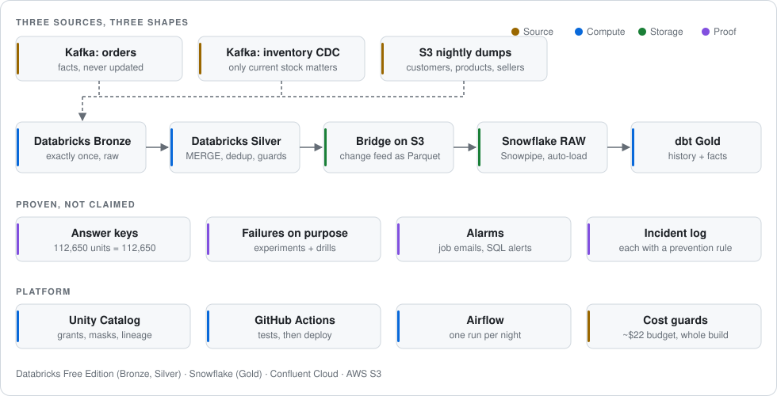

# ledgerline

[](https://github.com/malikvarun216-dot/ledgerline/actions/workflows/ci.yml)

**An e-commerce lakehouse and data warehouse on Databricks and Snowflake, built to stay correct when data
arrives twice, late, out of order, or is deleted.**

ledgerline runs 100,000 real e-commerce orders (the public Olist dataset) through a production-style platform:
Kafka streams and nightly S3 files into **Databricks** (Bronze and Silver on Delta Lake), then **Snowflake** and
**dbt** for the tables analysts read. Each layer uses the write pattern suited to its data, and each guarantee is
verified by deliberate failure testing.

<picture>
  <source media="(prefers-color-scheme: dark)" srcset="docs/images/architecture-dark.svg">
  
</picture>

| 3 | 17 | 112,650 = 112,650 | 167 |
|:---:|:---:|:---:|:---:|
| sources with different change patterns | failure scenarios tested and documented | units sold reconcile with stock changes across two streams | automated tests |

## Sources

Each source changes in a different way, and each needs a different write pattern:

| Source | How it changes | What the platform must get right |
|---|---|---|
| **Orders** (Kafka) | Facts. Never updated. | Load each event **exactly once**, even after a crash or a replay |
| **Stock levels** (Kafka, change data capture) | Changes constantly. Only "now" matters. | Apply changes **in order**; never let an old update overwrite a newer one; never let a deleted item come back |
| **Customers, products, sellers** (nightly files on S3) | Change slowly. History matters. | Know **who the customer was on the day of the order**, not just today |

The stock feed is driven by the real order lines, so the two streams must agree: units sold = units taken out of
stock, for every one of 34,448 products. That tie-out runs on Silver and again on Gold, and it is how I know nothing
was lost or doubled on the way.

## How it works

1. **Bronze (Databricks).** Raw data lands exactly once. Kafka offsets and Delta's transaction log make a replay
   provably safe, and nightly files are written once and never silently changed.
2. **Silver (Databricks).** Each source gets its own `MERGE`: snapshot files delete by absence, the change stream
   applies inserts, updates and deletes in sequence order, and orders fill in as their events arrive. Bad rows
   are held back with an alarm instead of stopping the night.
3. **Bridge.** Every change Silver makes (including deletes) is exported as Parquet to S3. **Snowpipe** loads it into
   Snowflake about 25 seconds after it is written.
4. **Gold (Snowflake + dbt).** Customer, product and seller history as SCD2 snapshots on business time; order facts
   as incremental models with a custom MERGE that also deletes; a point-in-time view that answers "who was the
   customer, and where was the seller, when this was sold". Checked against Olist's own per-order addresses, it
   was right **97,651 times out of 97,653**.

## Failure testing

Each guarantee is tested by breaking it deliberately: **experiments** (one failure mode each, with a test asserting
the bug is present before the fix) and **drills** (a whole layer attacked at once). Each result is written up in
[docs/incidents.md](docs/incidents.md) with a prevention rule.

Example: a stream's checkpoint was deleted on purpose and the stream restarted.
The job succeeded, reported no errors, and loaded no duplicates, so by every normal check it was healthy. It had
also **silently skipped 74 new messages**, permanently. The table's own log believed those batches were already
written. Now the stream refuses to start in that state, and the drill proves the refusal fires.

Other findings from the same process:

- The stock feed's "before" and "after" values broke their own sequence order on **237 products**. Every total and
  every test passed. Only a check that follows each product's chain of changes could see it.
- Snowflake's first load labelled all **504,039 rows** with the wrong table name, because the file path included the
  stage's own folder. A check that compares each label with its source now runs after every load.
- "Delete whatever is missing" is right for a full nightly snapshot and destructive on a batch of changes: on
  Snowflake it deleted **2,945 sellers** that had simply not changed that night. Measured, not assumed. Production
  reads each change's own delete flag instead.

## Operations

- **Production practices.** The Kafka topics, S3 buckets and tables are handled like production: a mistake is contained
  and fixed forward, never "fixed" by deleting the data and starting over.
- **Governed.** Unity Catalog grants, column masks, row filters and tags; synthetic personal data in its own lane,
  with a right-to-erasure job that is proven to delete physically.
- **Automated.** GitHub Actions runs lint and 167 tests, then deploys the Databricks jobs as code (Asset Bundles) as
  one service account, run by another. Job failure emails and SQL alerts, each seen firing.
- **Cost.** A **~$22 budget for the whole build**: Databricks Free Edition, a Snowflake trial with resource monitors and
  60-second auto-suspend, Confluent at about a cent a month at rest.

## Status

Bronze, Silver, the bridge and Gold are built and verified ([docs/progress.md](docs/progress.md) records what was
*verified*, not just what was written). Every dbt change is tested by **slim CI** on GitHub Actions, which builds
only the changed models on **zero-copy clones** of production. Gold and its history tables are permanent tables.
**In progress:** an Airflow DAG that runs each night end to end across all three platforms. **Next:** late-arriving
data, Snowflake masking and Time Travel, Streams, Tasks and Dynamic Tables, and query performance on a large sample.
The plan for every topic is in [docs/coverage.md](docs/coverage.md).

**Stack:** Python, PySpark, SQL, Databricks (Delta Lake, Structured Streaming, Auto Loader, Unity Catalog, Lakeflow),
Snowflake (Snowpipe, zero-copy clone), dbt, Kafka (Confluent Cloud), Airflow, AWS S3, GitHub Actions.

**More detail:** [design decisions](docs/decisions.md) (every choice with the option it rejected) ·
[incidents](docs/incidents.md) · [progress log](docs/progress.md) · [coverage plan](docs/coverage.md) ·
[runbook](docs/runbook.md)

<details>
<summary><b>Which write pattern goes where, and why</b></summary>

| Layer | Source | Pattern |
|---|---|---|
| Bronze | Order events | Append-only, exactly once via Kafka offsets (`txnAppId` / `txnVersion`); `mergeSchema` for added fields |
| Bronze | Dimension dumps | Auto Loader + `Trigger.AvailableNow` + `replaceWhere`; landing is write-once |
| Bronze | Inventory CDC | Append-only raw op log; Bronze does **not** interpret ops |
| Silver | Order events | `MERGE INTO` on `order_id`, one row per order filled in as events arrive |
| Silver | Dimensions | `MERGE` + `WHEN NOT MATCHED BY SOURCE DELETE`, with a 5% delete circuit breaker |
| Silver | Inventory CDC | `MERGE` on op flags + in-batch dedup + `seq` guard; newest event read from the log |
| Bridge | Every Silver table | Change Data Feed by version range → Parquet on S3 → Snowpipe → one `VARIANT` table |
| Gold | Dimensions | SCD2 via dbt snapshot (`timestamp` strategy, business time, one night per run) |
| Gold | Order facts | dbt incremental with a custom `merge_changes` strategy (in-band deletes, version guard) |

`WHEN NOT MATCHED BY SOURCE DELETE` is on the **snapshot** path only. Applied to a change batch it is destructive:
a change batch holds only the rows that changed, so every unchanged row looks "missing" and is deleted. Change-feed
deletes arrive in-band, as `op = 'D'`.

Where two patterns could both work, both were built and compared, and the choice is recorded with the one it
rejected, e.g. a hand-written MERGE vs Lakeflow `AUTO CDC`, a dbt snapshot vs `AUTO CDC` SCD2, or watermark dedup vs
`MERGE` dedup.

</details>

<details>
<summary><b>Run it locally</b></summary>

```bash
python -m pip install -r requirements-dev.txt
```

Get the data: Olist is on Kaggle and needs a free API token. Create it at
[kaggle.com/settings](https://www.kaggle.com/settings) → API → *Create New Token*, save `kaggle.json` to
`~/.kaggle/`, then accept the terms once on [the dataset page](https://www.kaggle.com/datasets/olistbr/brazilian-ecommerce).

```bash
python scripts/fetch_olist.py
```

Run the generators (local output, no credentials needed):

```bash
python generators/order_events.py --limit 2000
```

```bash
python generators/inventory_cdc.py --limit 2000 --delist-count 5
```

```bash
python generators/dim_dumps.py --nights 6 --stride-days 120 --delete-per-night 20
```

Tests and lint (same as CI):

```bash
python -m pytest tests/
```

```bash
python -m ruff check .
```

</details>

## Data

[Brazilian E-Commerce Public Dataset by Olist](https://www.kaggle.com/datasets/olistbr/brazilian-ecommerce):
about 100k orders, 2016-09 to 2018-10. Chosen because it has a real order lifecycle with several timestamps, and
customers whose address genuinely changes between orders. `data/` is gitignored; nothing here redistributes the
dataset.
